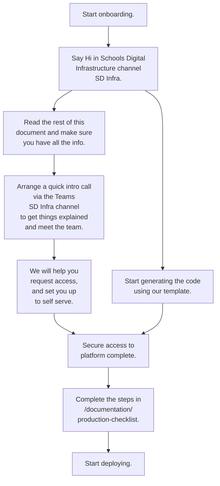

# Onboard a new service to the Teacher Services AKS cloud platform

Onboarding is straightforward and quick.



## Before you start

- Your application needs to be dockerized. The build workflow will make it available at ghcr.io/dfe-digital/your-service-name. You should make use of the relevant template application as the foundation for your new service:
  - [Rails](https://github.com/DFE-Digital/rails-template)
  - [.Net](https://github.com/DFE-Digital/CSharp-.NET-Template)
- If you are getting started on a local machine and you have an Apple
Silicon laptop, note that you will need to build your container with the
`--platform=linux/amd64` flag.
- Capture the information required upfront using the [Onboarding form](onboard-form-template.md), even if it is subject to change in the future. Keep it in hedgedoc and update it as you go along.
- Do not forget to check the [Production Checklist](production-checklist.md) at the end

## Template

Most services use the same pattern to deploy to AKS. It has been made into a template that will evolve over time to capture the best practices developed across multiple services.
It is used both to dramatically reduce the time required to onboard a new service, and to be a point of reference to align standards across repositories.

### Check `new_service` template parameter files

Check the `new_service` template parameter files against the [completed onboard questionnaire](https://github.com/DFE-Digital/teacher-services-cloud/blob/main/documentation/onboard-form-template.md)

- Populate the [environment parameters file](https://github.com/DFE-Digital/teacher-services-cloud/blob/main/templates/new_service_parameters.env) with the new project specific values.

Note for ENVIRONMENTS parameter there is no need to include **review or production**; these are mandatory environments and will be created automatically.
```
ENVIRONMENTS="development test preproduction"
```
Environment names are set per service, so the names in this example are illustrative. Use the names your service needs, and keep them consistent across the tfvars, workflow and GitHub environment settings.

Note:

- Check the [Terraform environment parameters file](https://github.com/DFE-Digital/teacher-services-cloud/tree/main/templates/new_service_config/terraform_env_vars) with the new project specific values.

### Generate code

Run the `make new_service` command.

This will create a new directory called `new_service`.


This can be built iteratively since the script will stop and show if a variable is missing. Example:

```
% make new_service
bash templates/new_service.sh
templates/new_service.sh: line 26: SERVICE_NAME: unbound variable
make: *** [new_service] Error 1
```

### Copy code to the service's repository

Make sure to copy all the files, including invisible files. Example:

```
cp -r teacher-services-cloud/new_service/. teacher-pay-calculator
```

Note that for an existing repository, this may clobber your `.gitignore`, `.tool-versions` and `Makefile`. Only add what is missing and check `git diff` to make sure you're not
losing information.


## Prepare new environment

These steps must be done by the infra team.

### Prepare the Kubernetes cluster

Configure the centrally managed aspects of the AKS setup for each environment, e.g.:

  - [test - `cluster/terraform_kubernetes/config/test.tfvars.json`](https://github.com/DFE-Digital/teacher-services-cloud/blob/main/cluster/terraform_kubernetes/config/test.tfvars.json)
  - [production - `cluster/terraform_kubernetes/config/production.tfvars.json`](https://github.com/DFE-Digital/teacher-services-cloud/blob/main/cluster/terraform_kubernetes/config/production.tfvars.json)

Some items will already be set, others will need to be added:

  - `namespaces` - add AKS namespaces
  - `ga_wif_managed_id` - after identity setup (tbc), add the project and its environments
  - `statuscake_alerts` - where required, add statuscake alerts and [production-checklist](production-checklist.md#statuscake)

### Login to Azure

Raise a [PIM request](https://technical-guidance.education.gov.uk/infrastructure/hosting/azure-cip/#privileged-identity-management-pim-requests) to either:

- `s189-teacher-services-cloud-test` for non production environments
- `s189-teacher-services-cloud-production` for production environments. This must be approved by another team member.

Then login to Azure using `az login`.

### Create terraform environment

A minimum set of Azure resources is required to manage this environment with Terraform:

- **resource group**: e.g. s189t01-rsm-ts-rg. Databases and other resources will be created in it. Developers will have read/write access to the resource group and the resources inside.
- **storage account**: e.g. s189t01rsmtstfsa. Contains a versioned blob container to store Terraform state files for remote Terraform state management.
- **keyvaults**: e.g. s189t01-rsm-ts-app-kv for application secrets and s189t01-rsm-ts-inf-kv for infrastructure secrets.

As these resources are required to use Terraform appropriately, these resources are instead deployed using ARM templates:

- Validate: `make <environment config> validate-arm-resources`. Example: `make development validate-arm-resources`
- Deploy: `make <environment config> deploy-arm-resources`. Example: `make development deploy-arm-resources`

### Monitoring

Create nonprod and prod monitoring resource group and action-group (upper nonprod (e.g. test/qa) and prod environments)
- Validate: `make <environment config> validate-monitoring-resources ACTION_GROUP_EMAIL=[refer to onboarding questionnaire]`
- Deploy: `make <environment config> deploy-monitoring-resources ACTION_GROUP_EMAIL=[refer to onboarding questionnaire]`

### Enable developers access

Amend the AD group of the area:

- Add the namespaces and resource groups to [the AD groups spreadsheet](https://educationgovuk.sharepoint.com/:x:/r/sites/teacher-services-infrastructure/Shared%20Documents/Azure/Teacher%20services%20AD%20groups.xlsx?d=wd9dfa57ba7a64515af86effd063d450a&csf=1&web=1&e=6MdA98). For instance if the service is in BAT, edit the BAT groups (delivery team and production PIM).
- [Raise CIP requests](https://dfe.service-now.com/mydfe?id=sc_cat_item&sys_id=51b0b9c5db1ff7809402e1aa4b96197d) to amend the 2 groups
- The developers should now have access to continue with the set-up

## Deploy new service

### Configure environment variables

The application is configured for each environment using [environment variables](https://12factor.net/config). The [application_configuration](https://github.com/DFE-Digital/terraform-modules/tree/main/aks/application_configuration) module allows setting the variables and mapping them to the application automatically. Internally, *non-secret variables* are stored in a Kubernetes configmap and *secret variables* are stored in a Kubernetes secret.

- Default rails variables are provided by [the terraform module](https://github.com/DFE-Digital/terraform-modules/blob/2fe7c6330db16abc2097cda37ff369c22b398f61/aks/application_configuration/resources.tf#L3)
- Custom non secret variables are configured in the environment yaml files: `terraform/application/config/review.yml`, `terraform/application/config/production.yml`, etc. e.g. external domain, feature flags... They are merged to the terraform module config_variables
- Custom secrets are manually configured in the application key vault created in [Create terraform environment](#create-terraform-environment), and loaded automatically by [the terraform module](https://github.com/DFE-Digital/teacher-services-cloud/blob/a14bc31bad011d3227c9787b1d60011431359373/templates/new_service/terraform/application/application.tf#L9). e.g. rails secret key, notify key...
- Access keys to resources created by terraform like databases or storage accounts are [configured directly via terraform](https://github.com/DFE-Digital/teacher-services-cloud/blob/a14bc31bad011d3227c9787b1d60011431359373/templates/new_service/terraform/application/application.tf#L19) in secret_variables

### Statuscake

If Statuscake monitoring is not required at this stage, comment out resources in `terraform/application/statuscake.tf` and the provider in `terraform/application/terraform.tf`. See the [production checklist](production-checklist.md#statuscake) for full configuration.

### Deploy application

Deploy the application, ingress, database...

- Plan: `make <environment config> terraform-plan`. Example: `make development terraform-plan`
- Apply: `make <environment config> terraform-apply`. Example: `make development terraform-apply`

## Custom domain

The new application uses a default domain in `test.teacherservices.cloud` in test and `teacherservices.cloud` in production. Usually a [custom domain](https://technical-guidance.education.gov.uk/infrastructure/hosting/dns/#page_toc) is required to present a familiar domain to end users, ending in either `education.gov.uk` or `service.gov.uk`.

The code deploys Azure DNS zone and Azure front door **in the production subscription**.

Before proceeding, ensure the following:

- The total length of any "subdomain.domain" (e.g. staging.getintoteaching.education.gov.uk) cannot exceed 64 characters
- [Generate the code](#generate-code) using the template to create:
  - domain.sh in global config
  - domains make commands
  - terraform code in terraform/domains/infrastructure and terraform/domains/environment_domains
- It is possible to set up multiple top-level domains. Duplicate the code in the json files, such as in [ITTMS](https://github.com/DFE-Digital/itt-mentor-services/blob/main/terraform/domains/environment_domains/config/production.tfvars.json).

### Create domains Terraform environment

Terraform management of domains environment resources require initial resources to be deployed using ARM templates:

- Validate: `make domains validate-arm-resources`
- Deploy: `make domains deploy-arm-resources`

### Deploy domains infrastructure

This deploys one DNS zone and one front door which will be used subsequently by all the domains.

- Plan: `make domains-infra-plan`
- Apply: `make domains-infra-apply`

### Delegate DNS zone

Take note of the name servers of the newly created DNS zone and request delegation from either:

- [Infrastructure and networks](https://technical-guidance.education.gov.uk/infrastructure/hosting/dns/#service-now) for the education.gov.uk zone
- [GDS](https://technical-guidance.education.gov.uk/infrastructure/hosting/dns/#official-service-gov-uk-domains) for the service.gov.uk zone

### Create custom domain per environment

This configures the custom domain for a particular environment in the previously created DNS zone and front door.

- Plan: `make <environment config> domains-plan`
- Apply: `make <environment config> domains-apply`

## Deploy via GitHub actions

When running the make commands locally, the Azure credentials provided by `az login` are used by:

- the [Terraform `azurerm` provider](https://registry.terraform.io/providers/hashicorp/azurerm/latest/docs) and [Azure CLI](https://learn.microsoft.com/en-us/cli/azure/) to authenticate to Azure and managed Azure resources
- [kubelogin](https://azure.github.io/kubelogin/) to authenticate to the Entra ID enabled AKS cluster. kubelogin is required by the [Terraform Kubernetes provider](https://registry.terraform.io/providers/hashicorp/kubernetes/latest/docs) and any [kubectl](https://kubernetes.io/docs/reference/kubectl/) commands.

When running in a GitHub actions workflow, authentication is made using [OIDC](https://docs.github.com/en/actions/security-for-github-actions/security-hardening-your-deployments/configuring-openid-connect-in-azure):
- the workflow runs in a GitHub environment
- this environment is declared as federated credential in a managed identity
- the managed identity is a permanent member of the same Entra ID group as the developers in [Enable developers access](#enable-developers-access). Developers are only temporary members through PIM. This gives it permission to manage Azure resources and kubernetes namespaces.

The steps below set up the GitHub Actions deployment for a service. See [AKS AD groups](https://educationgovuk.sharepoint.com/sites/teacher-services-infrastructure/SitePages/AKS%20AD%20groups.aspx) for more details.

1. Create the federated credentials by adding the service and environments to the `ga_wif_managed_id` variable
2. Check that the managed identity for each environment is a member of the correct Entra ID group and that the Entra ID group has the role assignments to allow the deployment. These details are recorded in [Teacher services AD groups.xlsx](https://educationgovuk.sharepoint.com/:x:/r/sites/teacher-services-infrastructure/Shared%20Documents/Azure/Teacher%20services%20AD%20groups.xlsx?d=wd9dfa57ba7a64515af86effd063d450a&csf=1&web=1&e=6MdA98).
3. Deploy via pull request on this repository
4. In the service repository, create repository secret `AZURE_TENANT_ID`, and for each environment, environment secrets `AZURE_CLIENT_ID` and `AZURE_SUBSCRIPTION_ID`. Get the values from the relevant managed identities in the Azure portal, or from the `ga_wif_config` output of terraform-kubernetes-plan.
5. Create or update the workflows and reference the above secrets. Note that there are [template deployment workflows](https://github.com/DFE-Digital/teacher-services-cloud/tree/main/templates/new_service/.github/workflows) created by `make new_service` and these should be used for any new services.

## Get ready for production

Follow the [production checklist](production-checklist.md) to make sure the service is ready for end users

## Add a new environment to an existing service

This information is useful for when adding an additional environment (for example, the [sap-sector](https://github.com/DFE-Digital/sap-sector) and [sap-public](https://github.com/DFE-Digital/sap-public) repositories required additional `preapproval` environments).

### Repository files

- `global_config/<environment>.sh`: sets `CONFIG`, `ENVIRONMENT`, `CONFIG_SHORT`, `CLUSTER`, `AZURE_SUBSCRIPTION`, `AZURE_RESOURCE_PREFIX`, `KV_PURGE_PROTECTION` and `TERRAFORM_MODULES_TAG`. Copy the closest existing environment and change the values.
- `Makefile`: add a `<environment>:` target that includes `global_config/<environment>.sh`, following the existing targets.
- `terraform/application/config/<environment>.tfvars.json` and `<environment>.yml`: environment-specific application values, such as cluster, namespace and feature flags.
- `terraform/domains/environment_domains/config/<environment>.tfvars.json`: custom domain per environment, if one is required.

### Workflows

- Add environment-specific jobs or deployment matrix entries in the service's workflows, e.g. `build-and-deploy`.

### Infrastructure and access

- Add any application and infra secrets to the environment's relevant Key Vaults.
- Create the GitHub environment in the service repository with service-specific variables/secrets.
- Confirm that the managed identity for GitHub Actions is a member of the correct AD group and has the correct role assignments at the correct scopes (see [Deploy via GitHub actions](#deploy-via-github-actions)).

## FAQ

### Why does my web application deployment time out?

It may be that the container fails to start.

By default, Kubernetes probes the web container on the `/healthcheck` endpoint and expects a successful response with a 200 HTTP code. If the application doesn't have this endpoint or returns an error, it will keep trying until it times out.

Solutions:

- Investigate the pod using `kubectl logs`
- If using rails, it may be that `config.force_ssl = true`. Kubernetes uses HTTP, so the endpoint must be excluded. Ref: [rails documentation](https://api.rubyonrails.org/classes/ActionDispatch/SSL.html)
- If your app uses a different endpoint, change it using: `probe_path = "/endpoint"`
- If your app doesn't have a healthcheck endpoint yet, disable the check temporarily using: `probe_path = null`
